# SecurePipeline

[](https://github.com/Seugne/cyber-platform-lab/actions/workflows/securepipeline-ci.yml)

> **DevSecOps software-supply-chain security pipeline — from source code to a hardened Kubernetes runtime.**

SecurePipeline is a hands-on DevSecOps project built around one question:

> **How can a delivery pipeline decide whether an application is trustworthy enough to progress toward deployment?**

The objective was not to collect security tools. It was to turn them into **enforcement points**. A secret, a blocking SAST finding, a fixable high-impact vulnerability, or a Kubernetes workload violating runtime policy must be able to stop progression.

The result is a reproducible path from a small Flask application to a hardened Kubernetes workload, with security evidence generated along the way.

## At a glance

| Area | Implementation |
|---|---|
| Application | Flask + Gunicorn |
| CI | GitHub Actions |
| Secret scanning | Gitleaks |
| SAST | Semgrep |
| SCA / image scanning | Trivy |
| SBOM | CycloneDX |
| Registry | GitHub Container Registry |
| Signing / provenance | Cosign + GitHub OIDC |
| Runtime | Kubernetes on Kind |
| Admission control | Kyverno |
| Git governance | PR + required CI checks on `main` |

---

## The security story

The application begins as source code. Before it is allowed to become a running workload, the pipeline progressively asks:

```text
Can I trust the source code?
        ↓
Can I trust the dependencies?
        ↓
Can I trust the final container image?
        ↓
Do I know what is inside that image?
        ↓
Can I prove which CI identity produced it?
        ↓
Can the workload run safely?
        ↓
Will Kubernetes reject a non-compliant workload?
```

The implemented flow is:

```text
Developer
   │
   ▼
GitHub / Pull Request
   │
   ▼
Gitleaks ─────────────── secrets gate
   │
   ▼
Semgrep ──────────────── SAST gate
   │
   ▼
Trivy filesystem ─────── dependency / SCA gate
   │
   ▼
Docker build
   │
   ▼
Trivy image ──────────── final artifact vulnerability gate
   │
   ▼
CycloneDX SBOM ───────── software inventory
   │
   ▼
Cosign + GHCR ────────── immutable digest + keyless signing
   │
   ▼
CycloneDX attestation ── image ↔ SBOM relationship
   │
   ▼
Kubernetes
   │
   ▼
Kyverno ──────────────── admission control
   │
   ▼
Hardened runtime
   │
   ▼
2 replicas + probes + Service + self-healing
```

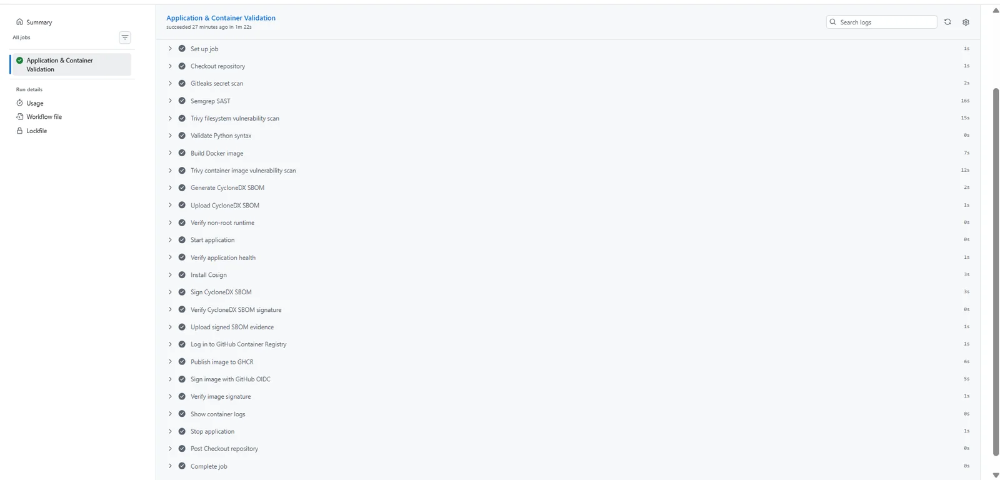

---

## Architecture

> **Draw.io architecture diagram coming next.**

The final architecture diagram will visualize the trust boundaries between GitHub, GitHub Actions, the security gates, GHCR, Sigstore/Cosign and Kubernetes. Until then, the flow above represents the controls that are actually implemented and tested in this repository.

---

## 1. Start with a deliberately small application

SecurePipeline uses a minimal Python/Flask service so that the project stays focused on delivery security rather than application complexity. Gunicorn serves the application on port `8080`, and `/health` is used by both CI and Kubernetes health checks.

```text
GET /
GET /health
```

The Docker image creates a dedicated runtime identity:

```text
UID = 10001
GID = 10001
```

and explicitly switches to that user with `USER 10001:10001`. The CI pipeline also verifies the effective identity rather than trusting the Dockerfile alone.

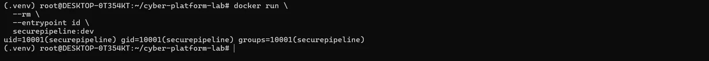

The runtime image also removes `pip` after dependencies are installed because package installation is unnecessary in production. This decision later became important when the final image scan exposed vulnerable components bundled with `pip`.

---

## 2. Make security scanners capable of blocking delivery

### Secrets: Gitleaks

Gitleaks scans the Git history before later stages execute. The intended decision is simple:

```text
Secret detected → BLOCK
```

The important design choice is that secret scanning happens before building or publishing artifacts.

### SAST: Semgrep — and the first real failure

I deliberately introduced a controlled vulnerable implementation using `shell=True`:

```python
command = f"ping -c 1 {target}"
subprocess.run(command, shell=True, check=True)
```

Semgrep detected the command-injection risk and blocked the pipeline.

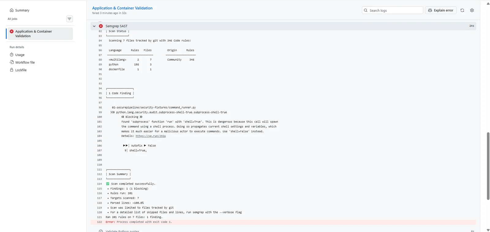

The remediation removed shell interpretation and passed arguments directly:

```python
subprocess.run(["ping", "-c", "1", target], check=True)
```

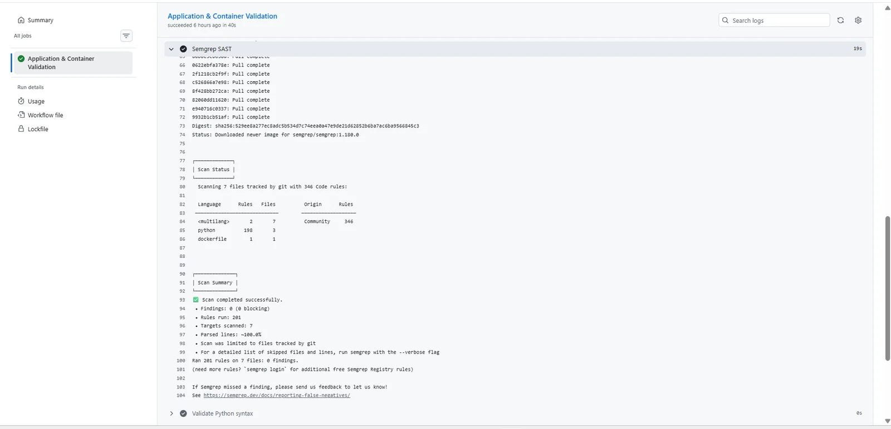

This was not just a vulnerability test. During the exercise, the first CI configuration scanned too narrow a path and initially produced a **false green**. I expanded the Semgrep scope to the complete `02-securepipeline` project before accepting the result.

That changed the lesson from "Semgrep is green" to:

```text
Vulnerability introduced
        ↓
Scanner scope challenged
        ↓
False-green condition identified
        ↓
Scope corrected
        ↓
Finding blocks CI
        ↓
Code remediated
        ↓
PASS
```

---

## 3. Scan twice: dependencies first, final artifact second

Trivy performs two different jobs.

The filesystem/SCA stage inspects dependencies before the image is built. The final-image stage scans what will **actually run**.

That distinction produced one of the most useful findings of the project. The final image scan surfaced HIGH-severity vulnerabilities that were not the story I saw from the earlier filesystem gate.

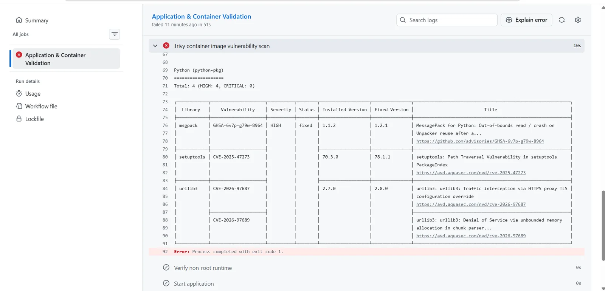

Investigation traced the findings to vendored components associated with the runtime `pip` installation. Instead of suppressing CVEs, I asked whether `pip` was needed in the production container. It was not.

So I removed the unnecessary runtime package, rebuilt the image and rescanned it.

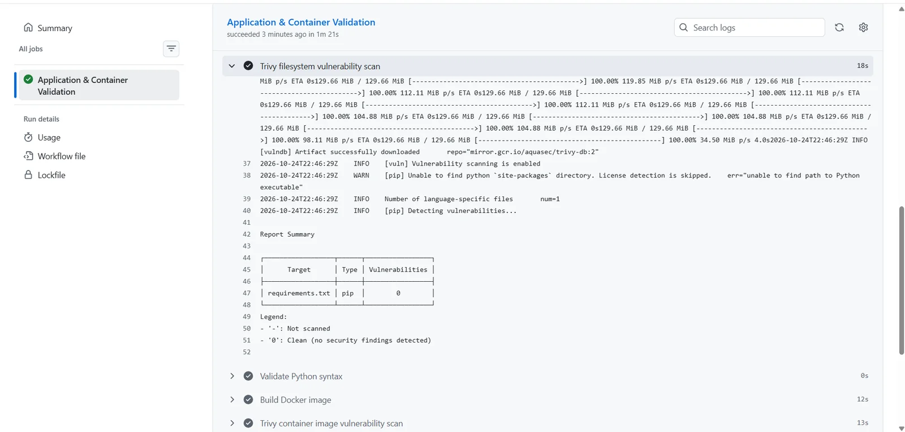

This produced a second real engineering cycle:

```text
Final artifact scan
        ↓
HIGH findings
        ↓
Root-cause analysis
        ↓
Unnecessary runtime component identified
        ↓
pip removed
        ↓
Image rebuilt
        ↓
PASS
```

The practical lesson is that source/dependency scanning and final-artifact scanning are complementary controls.

---

## 4. Move from "green scan" to software inventory

Once the image passes the vulnerability gates, the pipeline generates a **CycloneDX SBOM**. The generated SBOM is validated, uploaded as a GitHub Actions artifact, signed with Cosign, and its signature is verified.

The goal is to move from:

> "The scanner passed."

To:

> "I know what software was delivered, and I can verify the integrity of that inventory."

The implemented SBOM uses CycloneDX 1.7 and contained 97 discovered components during the validated run.

---

## 5. Publish by digest and establish provenance

Successful push pipelines publish the image to **GitHub Container Registry (GHCR)**. The workflow retrieves the registry digest and constructs an immutable reference:

```text
ghcr.io/.../securepipeline@sha256:...
```

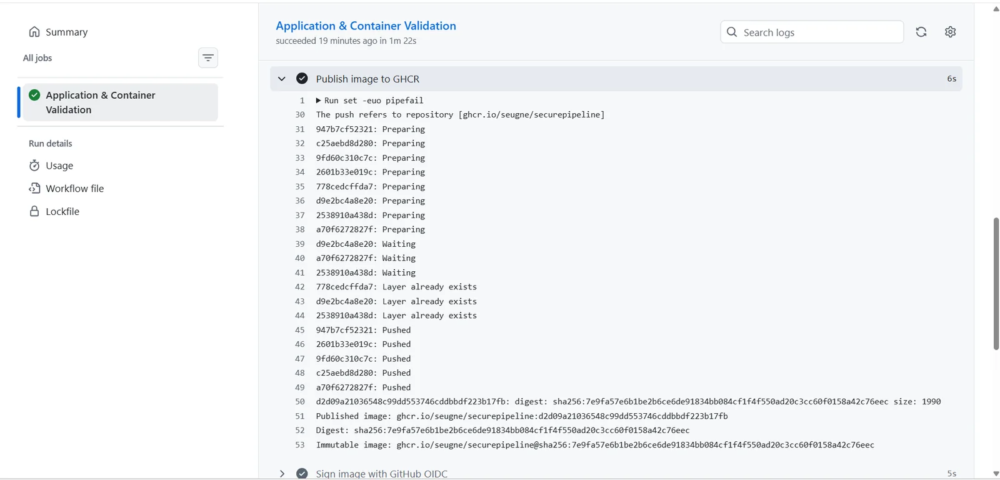

The image is then signed with **Cosign keyless signing using GitHub Actions OIDC**. No long-lived signing private key is stored in the repository.

Verification checks both the expected GitHub workflow identity and the GitHub OIDC issuer against the exact image digest.

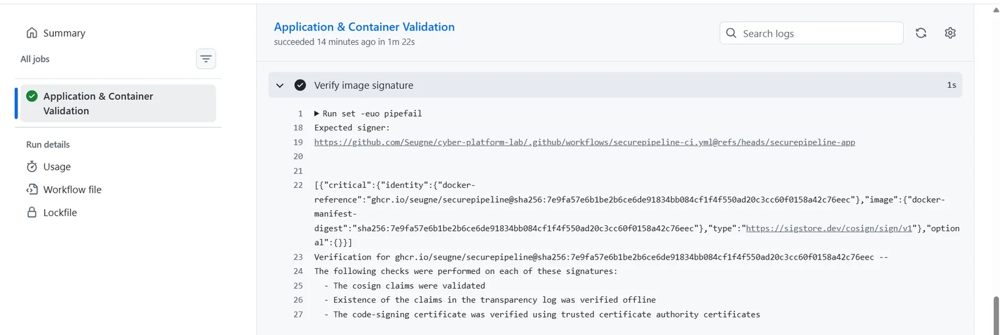

This answers a more useful supply-chain question than "was a signature present?":

> **Which workload identity produced and signed this exact artifact?**

---

## 6. Bind the SBOM to the exact image

Signing an image and signing an SBOM independently is useful, but SecurePipeline also creates a **CycloneDX attestation** whose subject is the exact image digest and whose predicate is the SBOM.

```text
Container image digest
          │
          │ signed attestation
          ▼
     CycloneDX SBOM
```

The pipeline immediately verifies that attestation.

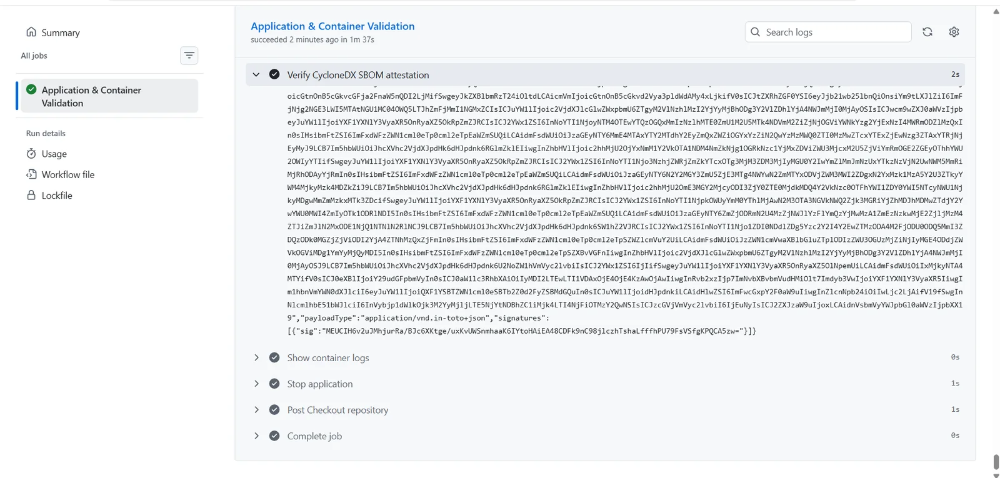

At this stage, the CI story covers source checks, artifact vulnerability, inventory, artifact identity and provenance.

---

## 7. Cross the next trust boundary: Kubernetes admission

The next question is no longer only whether the image passed CI. It is whether a workload should be admitted into Kubernetes.

SecurePipeline uses **Kyverno** with a namespaced validating policy. The current policy rejects Pods that attempt to use root UID or GID values.

A controlled escape attempt used:

```text
UID = 10001
GID = 0
```

and was rejected by the admission webhook before the Pod could run.

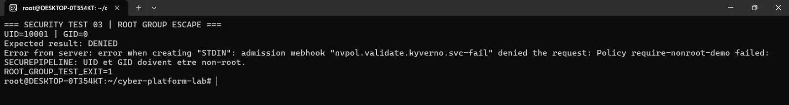

The real workload satisfies the policy with UID/GID `10001` and adds additional hardening:

```yaml
runAsNonRoot: true
runAsUser: 10001
runAsGroup: 10001
seccompProfile:
  type: RuntimeDefault
```

Container-level controls include:

```yaml
allowPrivilegeEscalation: false
readOnlyRootFilesystem: true
capabilities:
  drop:
    - ALL
```

A writable `/tmp` is mounted through `emptyDir`, while the root filesystem stays read-only.

---

## 8. Run the application as a real Kubernetes service

The Deployment maintains two SecurePipeline replicas and defines readiness/liveness probes plus CPU and memory requests/limits.

```text
ClusterIP Service :80
        │
        ├── Pod 1 → Gunicorn / Flask :8080
        └── Pod 2 → Gunicorn / Flask :8080
```

The Service routes traffic to healthy Pods and Kubernetes service discovery exposes the application internally as:

```text
securepipeline.securepipeline.svc.cluster.local
```

The health endpoint returns:

```json
{"service":"securepipeline","status":"healthy"}
```

---

## 9. Destroy a replica on purpose

A deployment is more convincing when failure is tested instead of assumed.

I deliberately deleted one of the two application Pods. The Deployment controller detected that actual state no longer matched desired state and created a replacement automatically.

```text
Desired replicas = 2
Actual replicas  = 1
        ↓
Deployment reconciliation
        ↓
Replacement Pod created
        ↓
2 healthy replicas restored
```

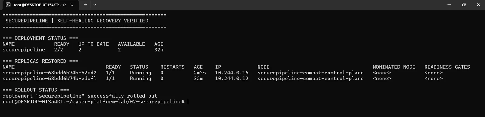

After recovery, I queried the application again through the Kubernetes Service rather than addressing an individual Pod.

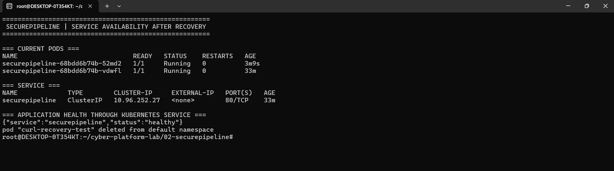

This demonstrates **reconciliation and self-healing**, not merely static YAML deployment.

---

## 10. Protect the trusted Git branch too

The technical pipeline would be weaker if a developer could simply bypass it and modify the trusted branch directly.

The repository now has an active ruleset named **`Protect main - PR + CI`** targeting the default branch. It enforces:

- a Pull Request before merge;
- the `Application & Container Validation` GitHub Actions check before merge;
- branch deletion protection;
- non-fast-forward / force-push protection.

The delivery model becomes:

```text
Feature branch
      ↓
Pull Request
      ↓
SecurePipeline CI
      ↓
Application & Container Validation
      ↓
PASS required
      ↓
Merge into main
```

This means the CI security gates are part of repository governance, not an optional dashboard.

---

## Engineering problems I had to solve

The project was not a straight happy path. The most useful problems were the ones that changed how I reasoned about the pipeline.

### 1. A scanner can be green and still be wrong

The controlled Semgrep regression initially exposed a scanner-scope defect. The tool itself was working, but the CI configuration was not scanning everything I thought it was scanning. I corrected the scope before accepting the result.

**Lesson:** validate the coverage of a security control, not just its exit code.

### 2. The final image told a different story from the source tree

Trivy's final-image scan found HIGH findings associated with a runtime component that was unnecessary. Removing `pip` was better than adding CVE suppressions.

**Lesson:** scan the exact artifact that will run and reduce runtime surface when possible.

### 3. Local Kubernetes context matters

During the Kind work, a previous cluster node stopped (`Exited 137`) after host lifecycle changes while another compatible cluster remained active. An image load initially targeted the stopped cluster. I diagnosed the mismatch by checking Docker node state and `kubectl` context, then explicitly targeted the active `securepipeline-compat` cluster.

**Lesson:** in Kubernetes troubleshooting, always establish the active context and actual node/container state before changing manifests.

### 4. APIs evolve

The classic Kubernetes `Endpoints` resource emitted a deprecation warning. I switched the verification step to the current `EndpointSlice` API.

**Lesson:** operational validation should follow the platform API, not only commands remembered from older versions.

### 5. Environment failures are different from application failures

A temporary WSL DNS issue blocked access to GitHub even though the repository and application were healthy. Isolating DNS from general connectivity prevented unnecessary changes to the project itself.

**Lesson:** separate environment/network faults from code and pipeline faults before remediating.

---

## What is enforced where?

| Control | Enforcement point | Security decision |
|---|---|---|
| Gitleaks | GitHub Actions | exposed secrets can block CI |
| Semgrep | GitHub Actions | blocking SAST findings fail CI |
| Trivy filesystem | GitHub Actions | fixable HIGH/CRITICAL dependency findings fail CI |
| Trivy image | GitHub Actions | final-image vulnerabilities fail CI |
| SBOM validation | GitHub Actions | invalid/empty SBOM fails CI |
| Non-root image runtime | GitHub Actions | wrong runtime identity fails CI |
| SBOM signature | Cosign / CI | SBOM integrity is verified |
| Image signature | Cosign / CI | published digest signer identity is verified |
| SBOM attestation | Cosign / CI | image ↔ SBOM relationship is verified |
| Non-root Pod policy | Kyverno admission | non-compliant Pods are denied |
| Runtime hardening | Kubernetes | hardened security context applied |
| Branch governance | GitHub ruleset | PR + successful CI required before merge |

---

## Important trust-boundary distinction

The local Kubernetes demonstration currently runs a locally loaded image:

```text
securepipeline:k8s-v1
```

The GitHub supply-chain workflow independently publishes, signs and verifies the GHCR image with Cosign and GitHub OIDC.

Therefore this project **does not claim that Kubernetes currently verifies the Cosign signature at admission time**.

Today:

```text
Cosign image-signature verification → CI
Kyverno non-root enforcement       → Kubernetes admission
```

Keeping that distinction explicit is intentional: this README documents controls that were actually implemented and tested, rather than claiming an integration that is still future work.

---

## Repository structure

```text
02-securepipeline/
├── app/
│   ├── __init__.py
│   └── app.py
├── k8s/
│   ├── deployment.yaml
│   ├── namespace.yaml
│   └── service.yaml
├── policies/
│   └── require-nonroot-demo.yaml
├── security-fixtures/
│   └── command_runner.py
├── Dockerfile
├── requirements.txt
└── README.md
```

The repository-level workflow is:

```text
.github/workflows/securepipeline-ci.yml
```

---

## Security decision model

SecurePipeline is built around a decision model rather than a scanner collection:

```text
Finding
   ↓
Severity
   ↓
Exploitability / relevance
   ↓
Fix available?
   ↓
Security policy
   ↓
ALLOW / WARN / BLOCK
```

Examples demonstrated in this project:

```text
Command-injection SAST finding      → BLOCK
Fixable HIGH final-image findings   → BLOCK
Root UID/GID at admission           → BLOCK
Hardened healthy workload           → ALLOW
```

---

## Current result

SecurePipeline now demonstrates:

- Gitleaks secret scanning;
- Semgrep SAST enforcement;
- Trivy dependency and final-image scanning;
- real FAIL → FIX → PASS security regressions;
- hardened non-root Docker runtime;
- CycloneDX SBOM generation and validation;
- SBOM signing and verification;
- GHCR publication by immutable digest;
- Cosign keyless image signing with GitHub OIDC;
- image-signature verification;
- signed CycloneDX image attestation;
- Kubernetes deployment with two replicas;
- readiness and liveness probes;
- hardened Pod/container security contexts;
- Kyverno admission enforcement;
- Kubernetes Service networking;
- self-healing after simulated Pod failure;
- GitHub governance protecting `main` with PR + CI enforcement.

The project evolved from:

```text
"run security tools"
```

into:

```text
"make security decisions and prove that they are enforced"
```

---

## Next evolution

The next improvements should deepen the existing trust chain rather than simply add more tools:

1. draw the final architecture and trust-boundary diagram;
2. verify the Cosign signature directly at Kubernetes admission;
3. require the CycloneDX attestation before admission;
4. add a dedicated DAST stage after deployment.
